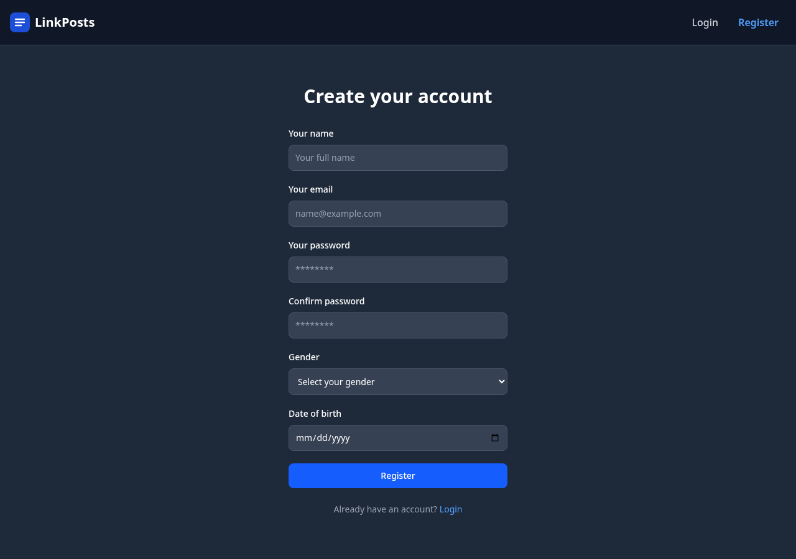
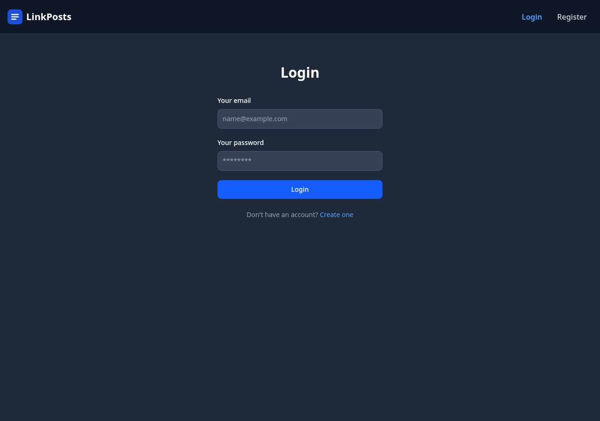

# LinkPosts

A social web app where users sign up, log in, and scroll a live feed of posts with comments. Built with React and Vite.

**Live demo:** https://malakmo7amed309.github.io/LinkPosts/

> Note: the training API behind the feed (Route Academy) is temporarily down, so the demo currently shows the auth pages and app shell; the feed loads once the API is restored.



## Features

- User registration with full client-side validation (zod + react-hook-form)
- Login with JWT token handling and automatic auth header on every request
- Protected feed: logged-out visitors are redirected to the login page
- Post feed with author, timestamp, images and comment counts
- Post details page showing the full post with all its comments
- Loading spinners, error states with retry, and toast notifications
- Logout from the navbar
- Responsive layout with a mobile menu (Tailwind CSS)

## Tech stack

- React 19 + Vite 7
- React Router 7
- Tailwind CSS 4
- react-hook-form + zod
- axios
- react-hot-toast

## Screenshots

| Register | Login |
| --- | --- |
|  |  |

## Getting started

```bash
npm install
npm run dev
```

Then open http://localhost:5173

Production build:

```bash
npm run build
npm run preview
```

## Project structure

```
src/
  api.js                  axios instance + token interceptor + error helper
  App.jsx                 routes
  Components/
    Layout/               shared layout with navbar
    Navbar/               auth-aware navbar with mobile menu + logout
    NotFound/             404 page
  Pages/
    Home/                 post feed
    PostDetails/          single post + comments
    Login/
    Register/
```

## Deployment

The project ships with a `vercel.json` rewrite rule for client-side routing, so it can be deployed to Vercel as-is.

## API

The app uses the Linked Posts training API (`https://linked-posts.routemisr.com`) from the Route training program for authentication and posts data.

**Live demo status:** a hosted demo is not available right now because the training API domain is currently down. The app handles this gracefully: failed requests show clear error messages with a retry option instead of crashing. Once the API is back, `npm install && npm run dev` runs the full app as described above.

## Author

Malak Mohamed
